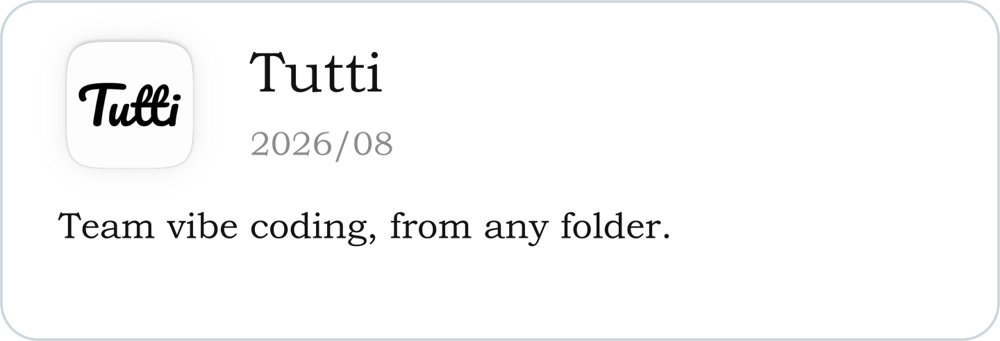

### Xiang Fei (xfey)

Make it happen.

### Recent Projects

<!-- apps:start -->

  
  

  
  

  
  

  
  

<!-- apps:end -->

*Code brewing... What’s the next one?*

### ✨ Featured
- [Tutti](https://tutti.now): Team vibe coding, from any folder.
- [Lobbyte](https://github.com/xfey/Lobbyte): Meet another human while your agents work.
- [HealthyVibe](https://github.com/xfey/HealthyVibe): Human, stay alive while AI vibes. Break. Breathe. Build.
- [Vibo](https://github.com/xfey/Vibo): Less IDE, more vibe. Minimal workbench for vibe coding.
- [Friends AI](https://apps.apple.com/us/app/friends-ai-group-chat/id6759603154): Group chat APP with several AI friends, now available on App Store.
- [MagicPaste](https://github.com/xfey/MagicPaste): Make your clipboard a little more magical.
- [Tip](https://github.com/TencentCloudADP/youtu-tip): Your proactive on-device AI assistant.
- [ContextOS](https://github.com/xfey/ContextOS): A proactive framework for AI assistants.
- [transformer-from-scratch](https://github.com/xfey/transformer-from-scratch): Practice Transformer implementation for interview prep.

### 📎 Academic
- [Workbuddy-Bench](https://github.com/Tencent/workbuddy-bench): A benchmark for evaluating coding agents on real-world work across code, web, office, and security tasks.
- [Youtu-Agent](https://github.com/TencentCloudADP/youtu-agent): A framework for building, running, evaluating, and training autonomous agents.
- [Post-Completion-Learning](https://github.com/xfey/Post-Completion-Learning): Code for the paper "Post-Completion Learning for Language Models".
- [MCP-Zero](https://github.com/xfey/MCP-Zero): Code for the paper "MCP-Zero: Active Tool Discovery for Autonomous LLM Agents".
- [Dolphin](https://github.com/bytedance/Dolphin): Code for the paper "Dolphin: Document Image Parsing via Heterogeneous Anchor Prompting".
- [NTIL](https://github.com/xfey/NTIL): Code for the paper "Advancing Sequential Numerical Prediction in Autoregressive Models".
- [MCTBench](https://github.com/xfey/MCTBench): Code for the paper "MCTBench: Multimodal Cognition towards Text-Rich Visual Scenes Benchmark".
- [RepAn](https://github.com/xfey/RepAn): Code for the paper "RepAn: Enhanced Annealing through Re-parameterization".
- [RMI-NAS](https://github.com/xfey/RMI-NAS): Code for the paper "Neural Architecture Search With Representation Mutual Information".
