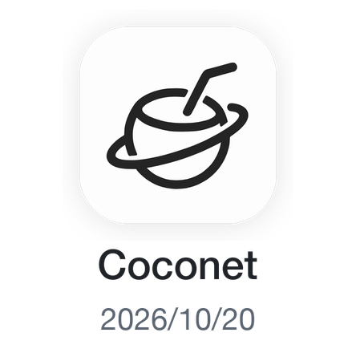
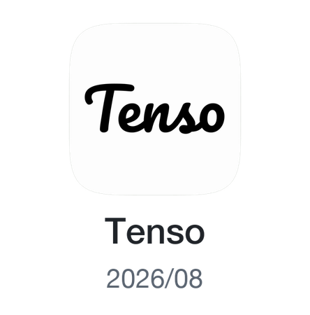
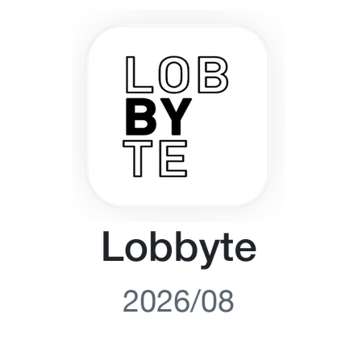
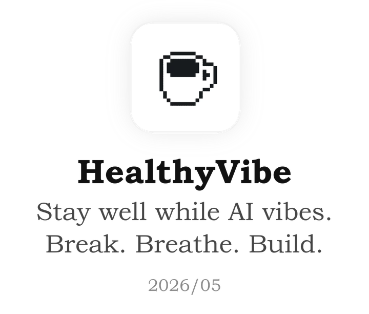
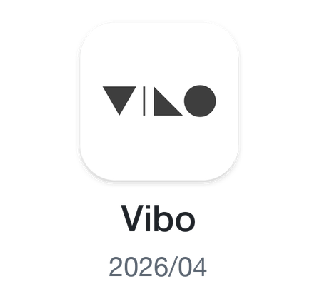
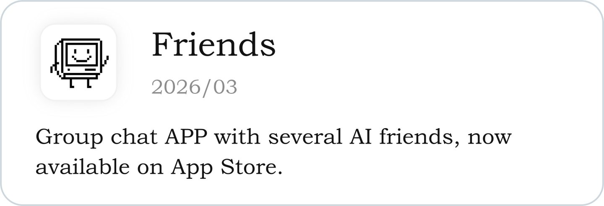
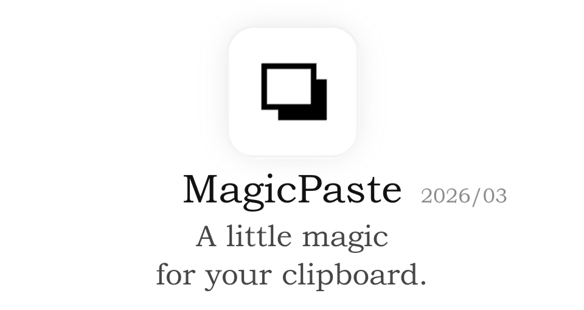
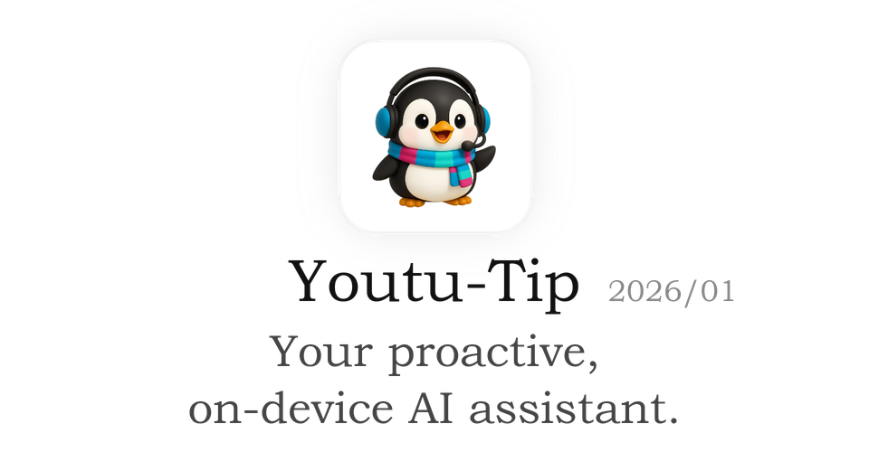
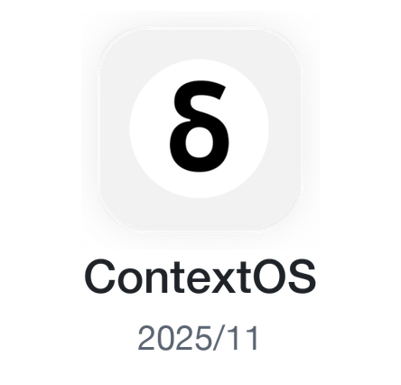

## Xiang Fei

Make it happen.

### Apps

<!-- apps:start -->

  <a href="https://github.com/xfey/coconet"><picture><source media="(prefers-color-scheme: dark)" srcset="./assets/apps/coconet-dark.png" /></picture></a>
  <a href="https://tenso.work"><picture><source media="(prefers-color-scheme: dark)" srcset="./assets/apps/tenso-dark.png" /></picture></a>
  <a href="https://github.com/xfey/Lobbyte"><picture><source media="(prefers-color-scheme: dark)" srcset="./assets/apps/lobbyte-dark.png" /></picture></a>
  <a href="https://github.com/xfey/HealthyVibe"><picture><source media="(prefers-color-scheme: dark)" srcset="./assets/apps/healthyvibe-dark.png" /></picture></a>

  <a href="https://github.com/xfey/Vibo"><picture><source media="(prefers-color-scheme: dark)" srcset="./assets/apps/vibo-dark.png" /></picture></a>
  <a href="https://apps.apple.com/us/app/friends-ai-group-chat/id6759603154"><picture><source media="(prefers-color-scheme: dark)" srcset="./assets/apps/friends-dark.png" /></picture></a>
  <a href="https://github.com/xfey/MagicPaste"><picture><source media="(prefers-color-scheme: dark)" srcset="./assets/apps/magicpaste-dark.png" /></picture></a>
  <a href="https://github.com/TencentCloudADP/youtu-tip"><picture><source media="(prefers-color-scheme: dark)" srcset="./assets/apps/youtu-tip-dark.png" /></picture></a>

  <a href="https://github.com/xfey/ContextOS"><picture><source media="(prefers-color-scheme: dark)" srcset="./assets/apps/contextos-dark.png" /></picture></a>

<!-- apps:end -->

### Experiments

- [transformer-from-scratch](https://github.com/xfey/transformer-from-scratch): Practice Transformer implementation for interview prep.

### Research

- [Workbuddy-Bench](https://github.com/Tencent/workbuddy-bench): A benchmark for evaluating coding agents on real-world work across code, web, office, and security tasks.
- [Youtu-Agent](https://github.com/TencentCloudADP/youtu-agent): A framework for building, running, evaluating, and training autonomous agents.
- [Post-Completion-Learning](https://github.com/xfey/Post-Completion-Learning): Code for the paper "Post-Completion Learning for Language Models".
- [MCP-Zero](https://github.com/xfey/MCP-Zero): Code for the paper "MCP-Zero: Active Tool Discovery for Autonomous LLM Agents".
- [Dolphin](https://github.com/bytedance/Dolphin): Code for the paper "Dolphin: Document Image Parsing via Heterogeneous Anchor Prompting".
- [NTIL](https://github.com/xfey/NTIL): Code for the paper "Advancing Sequential Numerical Prediction in Autoregressive Models".
- [MCTBench](https://github.com/xfey/MCTBench): Code for the paper "MCTBench: Multimodal Cognition towards Text-Rich Visual Scenes Benchmark".
- [RepAn](https://github.com/xfey/RepAn): Code for the paper "RepAn: Enhanced Annealing through Re-parameterization".
- [RMI-NAS](https://github.com/xfey/RMI-NAS): Code for the paper "Neural Architecture Search With Representation Mutual Information".
